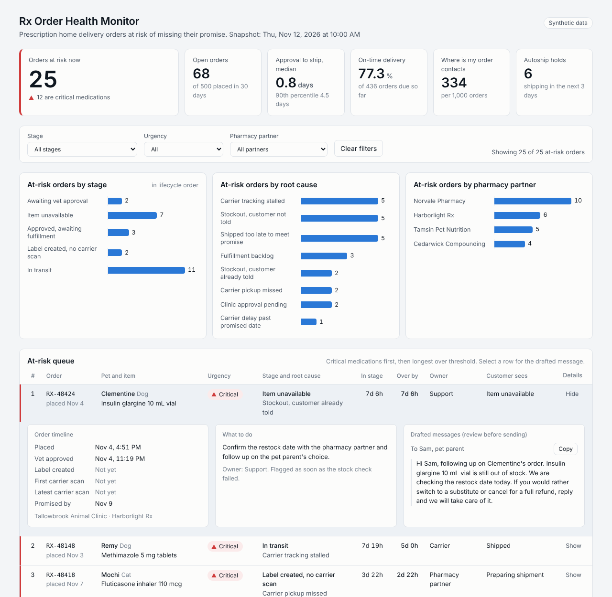

# Rx Order Health Monitor

A working prototype that watches prescription home delivery orders through every stage, flags the ones at risk of missing their delivery promise before the customer notices, and drafts the proactive message.

**Live dashboard:** https://mrmosleygit.github.io/rx-order-health-monitor/

**Product requirements:** [PRD.md](PRD.md)



## The problem

When a pet's medication is ordered for home delivery, the order passes through a vet clinic, a pharmacy partner and a carrier before it reaches the door. It can stall at any of those handoffs. Today most teams find out an order is in trouble when the pet parent calls to ask where it is. For a cat on thyroid medication or a dog on insulin, that is too late.

Public reviews of veterinary home delivery services describe the same failures again and again:

- Orders approved by the vet that sit for days without shipping
- Out of stock items the customer learns about a week later
- Orders marked "shipped" when only a label has been printed
- Autoship that keeps running after a clinic closes or an address changes
- No update until the customer asks for one

## What this prototype does

1. **Puts a clock on every stage.** Vet approval, fulfillment, carrier pickup and transit each have a threshold. An order that passes its threshold lands in the at-risk queue.
2. **Ranks the queue by medical urgency.** Critical medications (insulin, thyroid, heart, asthma) sort ahead of everything else, then orders are ranked by time over threshold.
3. **Tags a root cause and an owner.** Each exception says what went wrong and who needs to act: the clinic, the pharmacy partner, the carrier or support.
4. **Drafts the message.** Every flagged order comes with a ready to review note for the pet parent, plus a nudge for the clinic when the clinic owns the fix.
5. **Checks autoship before it charges.** Subscriptions shipping in the next 3 days are checked for a closed clinic, no refills left, or a recent address change that was never verified.
6. **Tells the truth about "shipped."** An order only shows as Shipped after a real carrier scan. A printed label shows as Preparing shipment.

## Results on the sample data

The sample is 500 synthetic orders over 30 days and 160 autoship subscriptions.

| Measure | Value |
| --- | --- |
| Open orders | 68 |
| Orders at risk | 25, of which 12 are critical medications |
| Approval to ship | 0.8 days median, 4.5 days at the 90th percentile |
| On-time delivery | 77.3% of 436 orders due |
| "Where is my order" contacts | 334 per 1,000 orders |
| Autoship holds | 6 |

The gap between the median and the 90th percentile is the story. Most orders are fine. The slow tail is where trust is lost, and it is the part a monitor like this makes visible.

## How it works

```
data/orders.csv ──────────┐
data/subscriptions.csv ───┤
                          ▼
                  src/monitor.py
        stage clocks, root cause, ranking,
          drafted messages, KPIs
                          │
        ┌─────────────────┼──────────────────┐
        ▼                 ▼                  ▼
output/at_risk_queue.csv  output/summary.json  docs/index.html
```

| Stage | Clock starts | At risk when |
| --- | --- | --- |
| Awaiting vet approval | Order placed | No approval after 24 business hours |
| Item unavailable | Stock check fails | Immediately |
| Approved, awaiting fulfillment | Vet approves | No shipping label after 24 business hours (72 for compounded items) |
| Label created | Label printed | No carrier scan after 24 hours |
| In transit | First carrier scan | Past the promised date, or no new scan for 48 hours |
| Autoship | 3 days before each ship date | Clinic inactive, no refills, or unverified address change |

All thresholds live in one dictionary at the top of `src/monitor.py`. They are starting points meant to be tuned against real data.

## Run it

Python 3.9 or later. No packages to install.

```bash
python src/generate_orders.py     # create the synthetic data (optional, a copy is included)
python src/monitor.py             # build the queue, the KPIs and the dashboard
python -m unittest discover tests # run the tests
```

Then open `docs/index.html` in a browser.

## Project structure

```
PRD.md                        product requirements: users, stories, acceptance criteria, KPIs
src/generate_orders.py        synthetic data generator
src/monitor.py                the monitoring engine
src/dashboard_template.html   dashboard layout, filled in by monitor.py
tests/test_monitor.py         22 tests tied to the acceptance criteria
data/                         sample orders and subscriptions
output/                       at-risk queue (CSV) and KPI summary (JSON)
docs/index.html               the built dashboard
```

## What I would do next

- Tune thresholds with real stage timing data, by item type and by partner
- Replace the templated messages with LLM drafts that a support agent reviews before sending
- Track whether each alert led to a contact before the customer reached out, to measure the proactive contact rate
- Add a weekly view of exceptions by root cause so recurring problems get fixed upstream
- Connect to live order and carrier tracking feeds in place of CSV snapshots

## About

All data in this repository is synthetic. Every clinic, pharmacy partner, pet and person is fictional, and no real company's data or systems were used.

Built with AI-assisted development (Claude).
